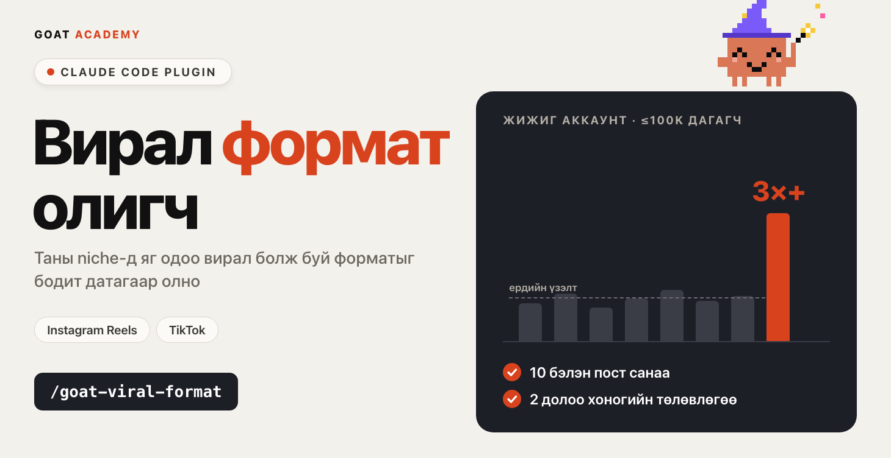

# 🐐 GOAT Academy: Claude Code plugin

<p align="center"></p>

GOAT Academy-ийн гишүүдэд зориулсан Claude Code plugin. Таны niche-д Instagram Reels болон
TikTok дээр **яг одоо вирал болж буй форматыг** бодит датагаар олж, танд зориулсан
**10 бэлэн пост санаа** болон traffic өсгөх **2 долоо хоногийн төлөвлөгөө**-г монголоор
гаргана.

## Суулгах

Claude Code дотор дараах хоёр командыг бичнэ:

```
/plugin marketplace add SaagiiSG/goat-academy-content-plugin
```

```
/plugin install goat-academy@goat-academy
```

Claude Code-ийг дахин нээгээрэй. Эхний чатад Claude өөрөө тохируулах заавраар (5 минут)
дагуулна. Дараа нь хэзээ ч `/goat-setup` гэж бичээд дахин тохируулж болно.

## Ашиглах

| Команд | Юу хийх |
|---|---|
| `/goat-viral-format` | Вирал формат олж, пост санаа + төлөвлөгөө гаргана |
| `/goat-setup` | Тохиргоо (дата tool холбох, туршилт) |

Командгүйгээр "Юу пост хийх вэ?", "Миний niche-д юу ажиллаж байна?" гэж асуухад ч болно.

## Вирал формат гэж юу вэ

**Жижиг аккаунт (≤100K дагагч) өөрийн ердийн видеоноосоо 3 дахин буюу түүнээс их үзэлт
авсан бичлэг.** Том аккаунт дагагчдынхаа хүчээр үзэлт авдаг. Жижиг аккаунтын огцом өсөлт
бол *формат* ажилласны баталгаа, үүнийг та давтаж чадна.

## Дата tool-ууд

| Сонголт | Үнэ | Тэмдэглэл |
|---|---|---|
| **Үнэгүй (үндсэн)**: [yt-dlp](https://github.com/yt-dlp/yt-dlp) (TikTok) + [Instaloader](https://github.com/instaloader/instaloader) (Instagram) | 0₮ | Plugin-д скрипт нь багтсан. TikTok заримдаа эвдэрдэг (yt-dlp-г шинэчлэхэд засагддаг), Instagram нэвтрэлт шаардаж магадгүй |
| **[Apify](https://apify.com)** (нөөц) | Сар бүр үнэгүй credit | Хамгийн найдвартай |
| **Юу ч холбохгүй** | 0₮ | Вэб хайлтаар ажиллана, тоон дата сул |

## Нууцлал

- Зөвхөн нийтэд нээлттэй бичлэгийн тоон үзүүлэлт (views, likes, comments) ба caption-ийг
  уншина. Дагагчдын жагсаалт, хувь хүний мэдээлэл цуглуулахгүй.
- Тохиргооны төлөвийг зөвхөн таны компьютерт (`~/.goat-academy/state.json`) хадгална.
  Хаашаа ч илгээхгүй.
- Нууц үг, token-оо хэзээ ч чатад бүү бич.

## Бүтэц

```
.claude-plugin/        plugin.json, marketplace.json
hooks/                 Эхний 3 чатад тохируулах зааврыг санал болгох hook
skills/goat-setup/     Тохируулах заавар
skills/goat-viral-format/
  SKILL.md             Вирал формат олигч
  references/          Форматын сан, tool-уудын заавар
  scripts/free_fetch.py  Үнэгүй scraper (yt-dlp + Instaloader)
```

---

**English:** A Claude Code plugin for GOAT Academy members. It finds viral Instagram Reels
and TikTok formats in a member's niche: posts from small accounts (≤100K followers) that got
3x+ the account's usual views (median of its other recent videos), fetched free with yt-dlp
and Instaloader, then turns them into 10 ready-to-shoot post ideas and a 2-week traffic plan,
in Mongolian. For a member's first 3 sessions, a SessionStart hook offers a guided setup.

License: MIT
